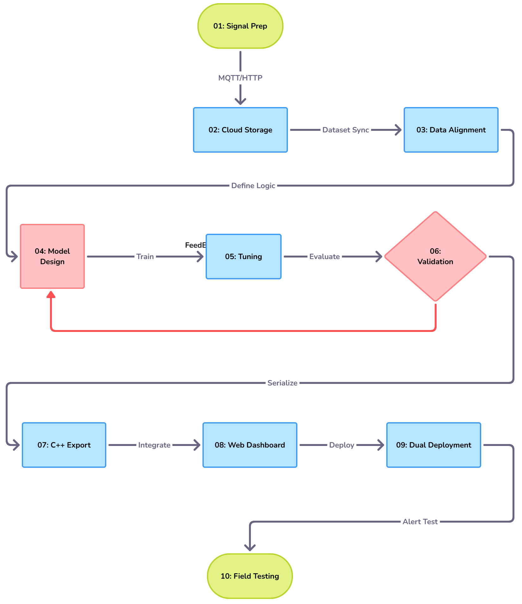

# Desision-Tree-based-Power-Cables-Theft-Detection-System-IOT-

# ⚡ Hybrid AI & TDR System for 3-Phase Power Cable Theft Detection and Fault Localization

**Author:** Eng. Mahmoud Souliman (ITE - Machine Learning)

---

 1. Abstract & Project Overview
This project introduces an intelligent, real-time monitoring and diagnostic system designed to protect three-phase electrical power transmission and distribution lines (L_1, L_2, L_3) against physical tampering and intentional cable theft. The core scientific contribution of this work lies in its Hybrid Edge-to-Cloud Architecture, combining:
1. Machine Learning (Decision Tree Classifier): An AI inference engine running on the cloud to analyze live electrical signatures and accurately distinguish between normal load fluctuations, utility power outages, and active cable cuts without false alarms.
2. Time Domain Reflectometry (TDR): A high-frequency physical pulse-injection unit that measures reflection time (t_{Ref}) to localize the exact distance of the cable cut in meters.

---

 2. System Architecture & Visual Diagram
The hardware architecture is split into a low-voltage logical control unit and a high-voltage protection and coupling interface, communicating seamlessly via local wireless protocols and cloud databases.

---

 3. Implementation Methodology
* Edge Sensing & Processing:** Utilizing independent PZEM sensors and an ESP32-S3 microcontroller to acquire real-time voltage, current, and active power metrics across all three phases.
* AI Decision Engine: Translating trained Decision Tree rules into lightweight cloud-integrated logic (`predictSystemState`) to evaluate phase voltage unbalance (V_{unbalance}) and current thresholds instantly.
* Cloud Integration: Real-time data streaming and alert logging via Google Firebase Realtime Database, coupled with a responsive Web Dashboard supporting PWA installation.

---
© 2026 Eng. Mahmoud Souliman. All rights reserved.
